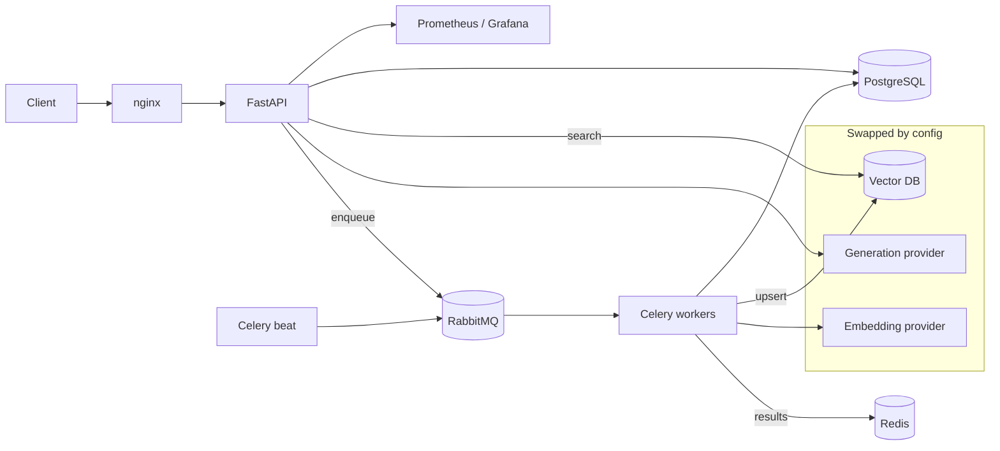

# mini-RAG

A production-shaped Retrieval-Augmented Generation service: upload documents, process and index them asynchronously, then ask questions and get answers grounded in the retrieved chunks.

The interesting part is not the RAG loop — it is that **nothing is hard-wired**. The LLM provider, the embedding provider, the vector database, and the prompt language are all swapped through configuration, not code. The same deployment runs against a hosted API or a local Ollama endpoint, and against pgvector or Qdrant, without a fork.

Built with FastAPI, Celery over RabbitMQ, PostgreSQL/pgvector, Qdrant, and a full observability and deployment stack.

---

## Architecture



**Request path.** A document is uploaded, chunked, embedded, and upserted into the vector store. A question is embedded, matched against the store, and the retrieved chunks are rendered into a locale-specific prompt template before generation — so answers stay anchored to the retrieved passages rather than to model memory.

**Everything heavy is asynchronous.** Chunking, embedding, and indexing run as Celery tasks on dedicated queues (`file_processing`, `data_indexing`, `default`), not inside the request. The API returns immediately; progress is observable through Flower and through task records in Postgres.

---

## Design decisions

These are the choices worth explaining, and why they were made that way.

### Providers behind interfaces, not imports

`LLMInterface` and `VectorDBInterface` define the contracts; `LLMProviderFactory` and `VectorDBProviderFactory` build the concrete provider named in config.

| Slot | Implementations | Selected by |
|---|---|---|
| Generation | Qwen (OpenAI-compatible), Cohere | `GENERATION_BACKEND` |
| Embedding | Qwen, Cohere | `EMBEDDING_BACKEND` |
| Vector store | pgvector, Qdrant | `VECTOR_DB_BACKEND` |

Adding a provider means implementing one interface and registering it in one factory. No call site changes.

### On-premises is a config switch, not a rewrite

Because the Qwen client speaks the OpenAI protocol, `QWEN_API_URL` decides where inference happens:

```bash
QWEN_API_URL="http://localhost:11434/v1/"                                  # local Ollama
QWEN_API_URL="https://dashscope-intl.aliyuncs.com/compatible-mode/v1"      # hosted
```

That single line is the difference between a cloud deployment and an air-gapped one. It matters for anyone who cannot send documents to a third party.

### Idempotent tasks

Retries and duplicate submissions are normal in a queue-backed system, and re-embedding a document is expensive. `IdempotencyManager` hashes the task name together with its arguments (SHA-256 over a canonical JSON encoding) and records every execution in a `celery_task_executions` table with its status, so repeated work is recognised rather than repeated. A scheduled maintenance task prunes that table.

### Prompts live outside the code

Prompt templates are stored per locale under `stores/llm/templates/locales/` — currently Arabic and English — and rendered through `TemplateParser`, with `PRIMARY_LANG` and `DEFAULT_LANG` selecting the language and its fallback. Revising a prompt or adding a language does not touch application logic.

### Deployments verify themselves

The GitHub Actions workflow deploys on push to `main` over SSH, restarts the `minirag.service` systemd unit, then polls the service port on an interval and **fails the deployment if the service does not come back up**. A deploy that silently kills the service is worse than one that never ran.

---

## API

Base prefix `/api/v1`.

| Method | Endpoint | Purpose |
|---|---|---|
| `POST` | `/data/upload/{project_id}` | Upload a document to a project |
| `POST` | `/data/process/{project_id}` | Chunk and store the uploaded content |
| `POST` | `/data/process_and_push/{project_id}` | Process then index, as a chained workflow |
| `POST` | `/nlp/index/push/{project_id}` | Embed and upsert chunks into the vector store |
| `GET` | `/nlp/index/info/{project_id}` | Inspect the project's collection |
| `POST` | `/nlp/index/search/{project_id}` | Semantic search over the project |
| `POST` | `/nlp/index/answer/{project_id}` | Retrieve, ground, and generate an answer |

A Postman collection is included at [`src/assets/mini-rag-app.postman_collection.json`](src/assets/mini-rag-app.postman_collection.json).

---

## Stack

| Layer | Technology |
|---|---|
| API | FastAPI, Pydantic settings, nginx |
| Async | Celery, RabbitMQ (broker), Redis (result backend), Flower |
| Data | PostgreSQL, SQLAlchemy (async), Alembic |
| Vectors | pgvector, Qdrant |
| Models | Qwen (OpenAI-compatible / Ollama), Cohere |
| Observability | Prometheus, Grafana, node-exporter, postgres-exporter |
| Delivery | Docker Compose, systemd, GitHub Actions |

---

## Running it

### Requirements

Python 3.10.

```bash
sudo apt update
sudo apt install libpq-dev gcc python3-dev
```

### Setup

```bash
conda create -n mini-rag python=3.10
conda activate mini-rag
pip install -r src/requirements.txt

cp src/.env.example src/.env      # set credentials, backends, and model IDs
alembic upgrade head
```

### With Docker Compose (recommended)

```bash
cd docker
cp env/.env.example.app        env/.env.app
cp env/.env.example.postgres   env/.env.postgres
cp env/.env.example.rabbitmq   env/.env.rabbitmq
cp env/.env.example.redis      env/.env.redis
cp env/.env.example.grafana    env/.env.grafana
# fill in credentials, then:
sudo docker compose up -d
```

| Service | URL |
|---|---|
| FastAPI | http://localhost:8080 |
| Flower | http://localhost:5555 |
| Grafana | http://localhost:3000 |
| Prometheus | http://localhost:9090 |

### Development mode

Run the API and each Celery process in its own terminal:

```bash
cd src
uvicorn main:app --reload --host 0.0.0.0 --port 5000
python -m celery -A celery_app worker --queues=default,file_processing,data_indexing --loglevel=info
python -m celery -A celery_app beat --loglevel=info
python -m celery -A celery_app flower --conf=flowerconfig.py
```

### Running a local model

To keep inference on your own hardware, start Ollama and point the service at it:

```bash
ollama serve
```

```bash
QWEN_API_URL="http://localhost:11434/v1/"
GENERATION_MODEL_ID="qwen3"
```

There is also a [Colab + ngrok notebook](https://colab.research.google.com/drive/1KNi3-9KtP-k-93T3wRcmRe37mRmGhL9p?usp=sharing) ([walkthrough](https://youtu.be/-epZ1hAAtrs)) for exposing a local Ollama server when you do not have a GPU to hand.

---

## Layout

```
src/
├── routes/          API layer — base, data, nlp, request schemas
├── controllers/     Orchestration — Data, Process, NLP, Project
├── models/          Persistence — SQLAlchemy schemes, enums, Alembic migrations
├── stores/
│   ├── llm/         LLMInterface, factory, providers, locale prompt templates
│   └── vectordb/    VectorDBInterface, factory, pgvector + Qdrant providers
├── tasks/           Celery tasks — file processing, indexing, workflow, maintenance, mail
└── utils/           Idempotency manager, Prometheus metrics
docker/              Compose stack, nginx, systemd unit, per-service env examples
```

---

## Licence

See [LICENSE](LICENSE).
